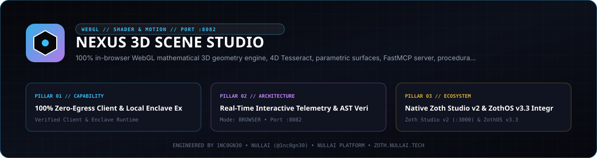

# Nexus 3D Scene Studio

<p align="center">
  
</p>

Pure-Python parametric 3D geometry synthesizer, Marching Tetrahedra SDF/TPMS isosurface polygonizer, analytic CSG evaluator, LOD mesh optimizer, multi-format exporter (`OBJ`, `STL`, `glTF 2.0`, `PLY`, Three.js `JSON`, standalone WebGL `HTML`), local REST server, and 12-tool Model Context Protocol (MCP) server. Zero external Python runtime dependencies.

- **Version**: `2.5.0`
- **Default Loopback Endpoint**: `http://127.0.0.1:8082`
- **Zoth Studio v2 Dossier**: [https://zoth.nullai.tech/tools/nexus-3d-scene-studio](https://zoth.nullai.tech/tools/nexus-3d-scene-studio)
- **Author**: 1nc0gn30 (`@1nc0gn30` · [https://1nc0gn30.si](https://1nc0gn30.si)) & NullAI ([https://nullai.tech](https://nullai.tech))
- **License**: MIT (100% free and open-source)

## Overview

Nexus 3D Scene Studio provides deterministic 3D mesh generation and topological analysis using only the Python standard library (`src/nexus_3d_scene_studio/`) paired with an interactive Three.js WebGL workstation (`public/index.html`):

- **Parametric & 4D Geometry (`geometry_engine.py`)**: 4D stereographic hypercubes (`tesseract`), `(p, q)` torus knots, deformed superquadrics (`pinch`, `taper`, `bend`, `twist`), Platonic solids, C60 Fullerene buckyballs, Mobius strips, Fibonacci sphere lattices, and multi-octave heightmap terrains.
- **Fractals & Attractors (`procedural_fractals.py`)**: Lorenz, Rossler, Aizawa, and Chen strange-attractor tube ribbons, Klein bottles, Menger sponges, and multi-tier LOD decimation pyramids.
- **Volumetric SDF & CSG Meshing (`sdf_isosurface.py`)**: Watertight Marching Tetrahedra polygonization of Triply Periodic Minimal Surfaces (`gyroid`, `schwarz_p`, `neovius`), Mandelbulb fractals, metaballs, and smooth/hard CSG boolean primitives.
- **Multi-Format Export & Budget Auditing (`mesh_exporter.py`, `scene_optimizer.py`)**: Wavefront `.obj` + `.mtl`, ASCII `.stl`, ASCII `.ply`, embedded-buffer `.gltf` 2.0, Three.js `BufferGeometry` JSON, standalone OrbitControls WebGL `.html`, complete `.zip` asset bundles, and polygon/VRAM budget grading.

## Architecture

```text
nexus-3d-scene-studio/
├── assets/hero-banner.svg                  # Studio vector banner
├── bin/nexus-3d.js                         # Unified CLI, web, and Electron launcher
├── docs/                                   # Math, export format, and MCP specifications
├── public/index.html                       # Interactive Three.js WebGL workstation
├── src/nexus_3d_scene_studio/
│   ├── geometry_engine.py                  # Parametric 3D/4D manifold generators
│   ├── procedural_fractals.py              # Strange attractors, Klein bottle, Menger, & LOD
│   ├── sdf_isosurface.py                   # Marching Tetrahedra SDF, TPMS, & CSG booleans
│   ├── mesh_exporter.py                    # OBJ, MTL, STL, PLY, glTF 2.0, Three.js, & HTML
│   ├── scene_optimizer.py                  # Polygon budget, VRAM, & bounding-box auditor
│   ├── ui_server.py                        # ThreadingHTTPServer REST API & static host (:8082)
│   ├── mcp_server.py                       # JSON-RPC 2.0 stdio MCP server (2024-11-05, 12 tools)
│   └── cli.py                              # Subcommand CLI (nexus-3d / scene-studio)
└── tests/                                  # Pytest geometry, SDF, glTF/PLY, CLI, MCP, & HTTP suite
```

## Quickstart

Clone the repository and install in editable mode:

```bash
git clone https://github.com/1nc0gn30/nexus-3d-scene-studio.git
cd nexus-3d-scene-studio
python3 -m pip install -e ".[dev]"
```

Start the local WebGL workstation and REST API on `127.0.0.1:8082`:

```bash
python3 server.py --port 8082
# or via the CLI / Node wrapper:
nexus-3d serve --host 127.0.0.1 --port 8082
node bin/nexus-3d.js web
```

Verify service health:

```bash
curl -s http://127.0.0.1:8082/health
```

## CLI & MCP Usage

### CLI Subcommands

Both `nexus-3d` (`scene-studio`) and `node bin/nexus-3d.js` expose the full CLI surface:

```bash
# Help, version, and JSON status
nexus-3d --help
nexus-3d --version
nexus-3d --status --json

# Generate procedural meshes to OBJ, STL, glTF, PLY, Three.js JSON, or standalone HTML
nexus-3d generate torus_knot -p "p=3,q=5" -f obj -o knot.obj
nexus-3d generate tesseract -p '{"size":2.0,"angle_4d":0.6}' -f gltf -o hypercube.gltf
nexus-3d generate buckyball -f html --theme dark -o viewer.html

# Audit polygon budget, surface area, bounding box, and VRAM footprint
nexus-3d audit torus_knot -p "p=3,q=7" --json
nexus-3d audit knot.obj --json

# Inspect MCP tool definitions or emit client configuration JSON
nexus-3d mcp --tools
nexus-3d mcp --config claude

# Runtime and platform diagnostics
nexus-3d platform --json
```

### ZothOS v3.4.0 Integration

On ZothOS v3.4.0 workstations, `nexus-3d` is installed on the system `PATH` and pairs with the Zoth Studio v2 dossier (`https://zoth.nullai.tech/tools/nexus-3d-scene-studio`) on loopback port `127.0.0.1:8082` with local-origin CORS protection (`localhost`, `127.0.0.1`, `::1`).

### REST API Endpoints (`127.0.0.1:8082`)

| Method | Path | Description |
| :--- | :--- | :--- |
| `GET` | `/health`, `/api/health` | Service status, version, uptime, and platform summary |
| `GET` | `/api/presets` | Default procedural shape presets and parameter schemas |
| `GET` | `/api/sdf/presets` | Available volumetric SDF and TPMS presets |
| `GET` | `/api/mcp/config` | Generate MCP client snippet (`?client=claude\|cursor\|cline\|zed\|generic`) |
| `GET` | `/api/diagnostics` | Detailed system and Python runtime diagnostics |
| `POST` | `/api/generate` | Generate a procedural mesh with Three.js JSON and budget audit |
| `POST` | `/api/sdf/generate` | Polygonize a volumetric SDF/TPMS preset via Marching Tetrahedra |
| `POST` | `/api/export` | Export mesh to `obj`, `stl`, `json`, `html`, `gltf`, or `ply` |
| `POST` | `/api/audit` | Audit raw mesh data or a named procedural shape |
| `POST` | `/api/export-zip` | Build a complete ZIP bundle (`OBJ`, `MTL`, `STL`, `glTF`, `PLY`, `JSON`, `HTML`, `audit.json`) |

### MCP Server (`stdio`)

Start the JSON-RPC 2.0 MCP server (`protocolVersion: 2024-11-05`):

```bash
nexus-3d mcp
```

Registered MCP tools (12) — see [docs/MCP_GUIDE.md](docs/MCP_GUIDE.md) for schemas:

- `nexus_generate_tesseract`, `nexus_generate_torus_knot`, `nexus_generate_superquadric`, `nexus_generate_solid`, `nexus_generate_terrain`
- `nexus_generate_fractal`, `nexus_generate_lod_pyramid`, `nexus_generate_sdf_isosurface`, `nexus_evaluate_csg_boolean`
- `nexus_export_mesh`, `nexus_audit_mesh`, `nexus_get_diagnostics`

## Testing & Verification

Run the full test suite and secret scan locally:

```bash
python3 -m pytest -q
node bin/nexus-3d.js --status --json
gitleaks detect --source . --no-banner --redact
```

## Support

Nexus 3D Scene Studio is 100% free and open-source with zero paywalls. Optional community support: [Buy Us a Coffee via Stripe](https://buy.stripe.com/3cIfZg27PdKo2D64Ocfw40X).

## License

Released under the [MIT License](LICENSE). Copyright (c) 2026 1nc0gn30 & NullAI ([https://nullai.tech](https://nullai.tech)).
